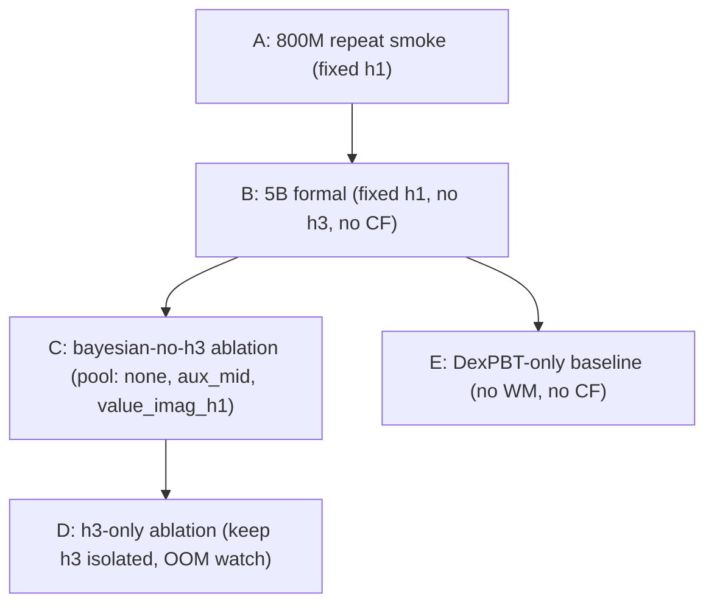

# Ablation Roadmap (post no-h3 smoke)

This file documents the four ablation tracks the team plans to run after
the no-h3 PBT smoke (`regrasping_cbwm_smoke_800m_p2_1_no_h3_20260605_135426`)
was sealed. The scope here is **planning only** — no scripts beyond those
listed in `RUN_FINAL_STATUS.md` are produced by this document.

## Constraints carried into every track

- No PPO, reward, observation-dim, WM-architecture, or CF-runner change.
- `max_consecutive_successes=50` stays the training cap; cap-sweep is
  eval-only via `results/eval_cap_sweep.py`.
- `value_imag_h3` is NOT on the main line. It is reserved for track D.
- All tracks reuse the staggered launch / per-policy XDG isolation /
  startup watchdog infrastructure.

## Track summary

## A. 800M repeat smoke (fixed h1)

- Launcher: [`results/start_regrasping_fixed_h1_p2_1_smoke_800m.sh`](start_regrasping_fixed_h1_p2_1_smoke_800m.sh).
- Goal: reproducibility check for the no-h3 smoke conclusions.
- Knobs:
  - `BASE_SEED=43` (or any non-42) to confirm seed-family independence.
  - `DEXPBT_MAX_ACTIVE=2`, default cooldown 50M.
- Pass criterion (gate to track B):
  - completed-only median end_mean ≥ ~9 (matches no-h3 smoke median 9.10).
  - all 6 policies start, startup_hang=0.
  - at least 1 cross-restart and 1 recovery-restart across the population.

## B. 5B formal (fixed h1, no h3, no CF)

- Launcher: [`results/start_regrasping_fixed_h1_p2_1_formal_5b.sh`](start_regrasping_fixed_h1_p2_1_formal_5b.sh).
- Goal: long-horizon formal run with relaxed PBT cooldowns.
- Knobs:
  - `--curriculum_rollback_cooldown_frames 200000000` (vs 50M smoke).
  - `--pbt_min_frames_as_source_after_restart 100000000` (vs 50M smoke).
  - `--pbt_min_frames_between_restarts 100000000` (vs 50M smoke).
  - `--pbt_usable_live_min_mean 2.0` (formal threshold).
- Post-run analysis:
  - `python results/generate_smoke_report_p2.py <RUN>` for acceptance + audit.
  - `python results/eval_cap_sweep.py --run-dir <RUN> --caps 50 100 200`
    for higher-cap upper-tail probe (eval-only).
  - `python results/eval_nsucc_percentile.py --run-dir <RUN>` for
    across-policy percentiles.

## C. Bayesian-no-h3 ablation

- Goal: validate the CB-WM strategy selector with `value_imag_h3` excluded.
- Strategy pool: `{none, aux_mid, value_imag_h1}`.
- Reuses launcher B as a template; replace
  `--wm_strategy_mode fixed --fixed_wm_strategy value_imag_h1`
  with `--wm_strategy_mode bayesian` and add a flag controlling the
  active strategy pool (existing observer plumbing).
- Pass criterion: posterior `n` for `value_imag_h1` and `aux_mid` both
  update beyond initialization (current no-h3 smoke had `n=1` because the
  selector was fixed); end_mean median should not regress below B.

## D. h3-only ablation

- Goal: characterize the OOM hint observed in the no-h3 smoke without
  polluting the main line.
- Setup: copy launcher B template, set
  `--wm_strategy_mode fixed --fixed_wm_strategy value_imag_h3`.
- Run in an isolated workspace; closely watch `OOM Diagnosis` section
  of the report.
- Pass criterion: confirm or reject that h3-only OOM is the dominant
  failure mode (vs an interaction with the other strategies).

## E. DexPBT-only baseline

- Goal: paper-style ablation showing CB-WM contribution.
- Setup: `--no-enable_wm` and `--no-enable_counterfactual` on launcher B.
  Existing baseline launcher [`results/start_regrasping_baseline_p1.sh`](start_regrasping_baseline_p1.sh)
  can be retargeted with the same staggered-launch knobs.
- Compare against B's population end_mean / retention.

## Ordering decisions

- A first: cheap, ~hours, validates that the no-h3 smoke result was not
  seed-luck.
- B before C: we need a stable fixed-h1 baseline before comparing the
  bayesian selector against it.
- D in parallel with C if hardware allows; D doesn't depend on C.
- E last: it's a paper-style ablation that should ride on B's run config.

## Out of scope (logged here, not run now)

- p1 retraining or PBT algorithm change suggested by the audit.
- Per-env percentile logging in training; current plan keeps it eval-only.
- Reintroducing `value_imag_h3` to the main strategy pool.
