# CCRS Report — base-retention 5B

## Pre-registered decision criteria (frozen before sweep results)

PRIMARY metric: normalized_nsucc Q(k, τ) = E[min(nsucc, M)]/M, M=50.
Effect threshold: |Δ normalized_nsucc| >= 0.05 (≈ 2.5 raw nsucc at M=50)
with 95% hierarchical paired-bootstrap CI excluding 0, computed ONLY when
reset fingerprints of the compared cells match exactly. success_any_rate
(P(nsucc>0)) is auxiliary and never used for these verdicts.
Tolerances in meters (cm shown for readability).

- **A (crossing)**: p4(peak) significantly better than p1(peak) at
  τ ∈ {0.020, 0.019, 0.018} AND p1 significantly better at
  τ ∈ {0.023, 0.022, 0.021} → capability curve crossing; population has a
  stable-capability vs high-precision division of labor → proceed to
  Anchor-Scout CD-ReST validation.
- **B (p4 dominant)**: p4 better on ≥70% of grid tolerances and all
  significant cells favor p4 → p4 is globally stronger; continue fine
  curriculum from p4 rather than adding cross-worker transfer mechanisms.
- **C (p1 still better at 0.020 m)**: p4's low live tolerance does not prove
  high-precision capability; audit dynamic curriculum, sampling variance and
  evaluation criteria.
- **D (p5 peak vs tip)**: significant fixed-tolerance Q drop (peak - tip) →
  real policy forgetting; otherwise (live nsucc drop but flat fixed-tol Q)
  → criterion reclassification dominant.
- If reset pairing is invalid for a comparison, its verdict degrades to
  reset_pairing_invalid and NO significance conclusion is produced.

## Verdicts (auto-applied pre-registered criteria, normalized_nsucc)

- p1 vs p4: **C_p1_still_better_at_high_precision**
- p5 peak→tip: **real_policy_forgetting**

## p4 − p1 (Δ normalized_nsucc; nsucc_mean and success_any_rate shown as context only)

| tol (m) | tol (cm) | ΔQ | 95% CI | sig | pairing | nsuccA/B | anyA/B |
|---|---|---|---|---|---|---|---|
| 0.0280 | 2.80 | -0.080 | [-0.101, -0.059] | yes | ok | 39.7/43.7 | 0.99/0.99 |
| 0.0250 | 2.50 | -0.083 | [-0.110, -0.049] | yes | ok | 39.1/43.3 | 0.99/0.99 |
| 0.0230 | 2.30 | -0.066 | [-0.097, -0.036] | yes | ok | 38.9/42.2 | 0.99/0.99 |
| 0.0220 | 2.20 | -0.080 | [-0.102, -0.060] | yes | ok | 37.6/41.6 | 0.99/0.98 |
| 0.0210 | 2.10 | -0.091 | [-0.119, -0.059] | yes | ok | 36.9/41.4 | 0.99/0.98 |
| 0.0200 | 2.00 | -0.088 | [-0.121, -0.052] | yes | ok | 35.2/39.6 | 0.99/0.98 |
| 0.0190 | 1.90 | -0.113 | [-0.138, -0.089] | yes | ok | 32.5/38.1 | 0.98/0.98 |
| 0.0180 | 1.80 | -0.127 | [-0.151, -0.105] | yes | ok | 29.1/35.5 | 0.97/0.97 |

## p5 peak − tip (Δ normalized_nsucc)

| tol (m) | tol (cm) | ΔQ | 95% CI | sig | pairing | nsuccA/B | anyA/B |
|---|---|---|---|---|---|---|---|
| 0.0280 | 2.80 | +0.118 | [+0.096, +0.139] | yes | ok | 45.4/39.5 | 0.99/0.97 |
| 0.0250 | 2.50 | +0.122 | [+0.103, +0.140] | yes | ok | 45.1/39.0 | 0.99/0.97 |
| 0.0230 | 2.30 | +0.140 | [+0.118, +0.163] | yes | ok | 44.9/37.9 | 0.99/0.97 |
| 0.0220 | 2.20 | +0.147 | [+0.126, +0.169] | yes | ok | 44.6/37.2 | 0.99/0.97 |
| 0.0210 | 2.10 | +0.145 | [+0.123, +0.169] | yes | ok | 44.1/36.8 | 0.99/0.96 |
| 0.0200 | 2.00 | +0.135 | [+0.110, +0.162] | yes | ok | 42.6/35.9 | 0.99/0.96 |
| 0.0190 | 1.90 | +0.101 | [+0.081, +0.122] | yes | ok | 40.6/35.6 | 0.99/0.96 |
| 0.0180 | 1.80 | +0.083 | [+0.059, +0.107] | yes | ok | 38.0/33.8 | 0.99/0.96 |

## Exact D/F/C — within-lineage transitions (policy forgetting analysis)

| worker | iters | tol a→b (m) | D | F | C | n | pairing |
|---|---|---|---|---|---|---|---|
| p1 | 106→108 | 0.0290→0.0276 | +0.022 | +0.018 | +0.004 | 2048 | ok |
| p1 | 133→134 | 0.0276→0.0262 | +0.129 | +0.093 | +0.036 | 2048 | ok |
| p1 | 139→140 | 0.0262→0.0249 | +0.094 | +0.088 | +0.007 | 2048 | ok |
| p1 | 146→147 | 0.0249→0.0237 | -0.050 | -0.055 | +0.005 | 2048 | ok |
| p1 | 149→150 | 0.0237→0.0225 | +0.085 | +0.081 | +0.003 | 2048 | ok |
| p1 | 153→154 | 0.0225→0.0214 | +0.067 | +0.063 | +0.004 | 2048 | ok |
| p1 | 157→158 | 0.0214→0.0203 | +0.235 | +0.218 | +0.017 | 2048 | ok |
| p4 | 109→110 | 0.0290→0.0276 | -0.024 | -0.073 | +0.049 | 2048 | ok |
| p4 | 113→114 | 0.0276→0.0262 | -0.031 | -0.034 | +0.003 | 2048 | ok |
| p4 | 120→121 | 0.0262→0.0249 | -0.002 | -0.009 | +0.007 | 2048 | ok |
| p4 | 124→125 | 0.0249→0.0237 | -0.094 | -0.111 | +0.018 | 2048 | ok |
| p4 | 128→129 | 0.0237→0.0225 | -0.092 | -0.106 | +0.013 | 2048 | ok |
| p4 | 139→140 | 0.0225→0.0214 | -0.031 | -0.034 | +0.003 | 2048 | ok |
| p4 | 143→144 | 0.0214→0.0203 | -0.050 | -0.083 | +0.033 | 2048 | ok |
| p4 | 149→150 | 0.0203→0.0193 | +0.026 | +0.015 | +0.011 | 2048 | ok |
| p4 | 154→155 | 0.0193→0.0183 | +0.158 | +0.142 | +0.016 | 2048 | ok |
| p5 | 100→102 | 0.0290→0.0275 | +0.028 | +0.019 | +0.009 | 2048 | ok |
| p5 | 108→109 | 0.0275→0.0262 | -0.042 | -0.050 | +0.008 | 2048 | ok |
| p5 | 112→113 | 0.0262→0.0249 | +0.001 | -0.009 | +0.010 | 2048 | ok |
| p5 | 116→117 | 0.0249→0.0236 | -0.013 | -0.009 | -0.004 | 2048 | ok |
| p5 | 120→121 | 0.0236→0.0224 | -0.020 | -0.031 | +0.011 | 2048 | ok |
| p5 | 129→130 | 0.0224→0.0213 | -0.014 | -0.036 | +0.022 | 2048 | ok |

## Missing exact transition cells

- p0 it112->113 tol 0.02986954884717398->0.028376071404815278
- p0 it117->118 tol 0.028376071404815278->0.026957267834574514
- p0 it121->122 tol 0.026957267834574514->0.025609404442845787
- p0 it138->139 tol 0.026957267834574514->0.025609404442845787
- p0 it146->147 tol 0.026957267834574514->0.025609404442845787
- p0 it151->152 tol 0.026957267834574514->0.025609404442845787
- p0 it154->155 tol 0.025609404442845787->0.024328934220703497
- p0 it158->159 tol 0.024328934220703497->0.023112487509668322
- p2 it112->113 tol 0.0297302669104079->0.028243753564887505
- p2 it119->120 tol 0.028243753564887505->0.02683156588664313
- p2 it137->138 tol 0.02683156588664313->0.02548998759231097
- p3 it104->106 tol 0.029046297037257196->0.027593982185394335
- p3 it110->111 tol 0.027593982185394335->0.02621428307612462
- p3 it114->115 tol 0.02621428307612462->0.024903568922318386
- p3 it157->158 tol 0.024903568922318386->0.023658390476202464

## Missing / degraded sections

- missing exact transition cells for 15 transitions

## Figures

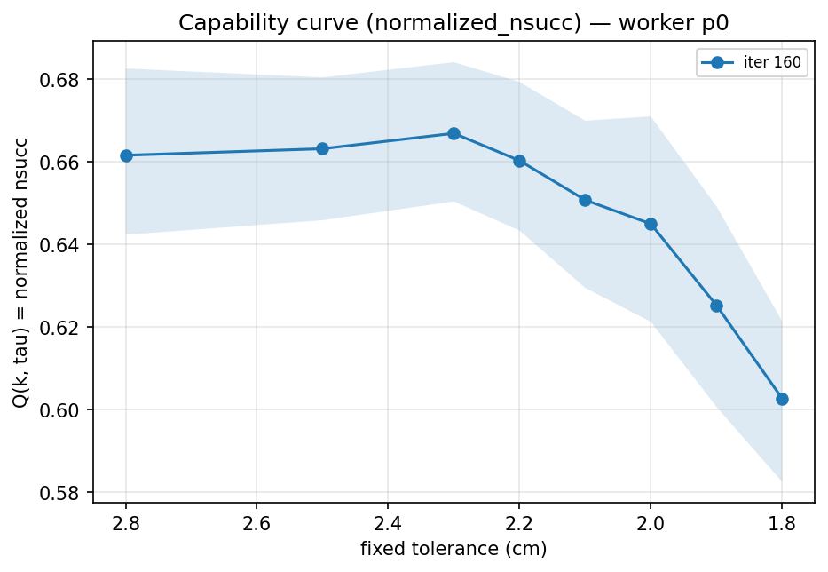
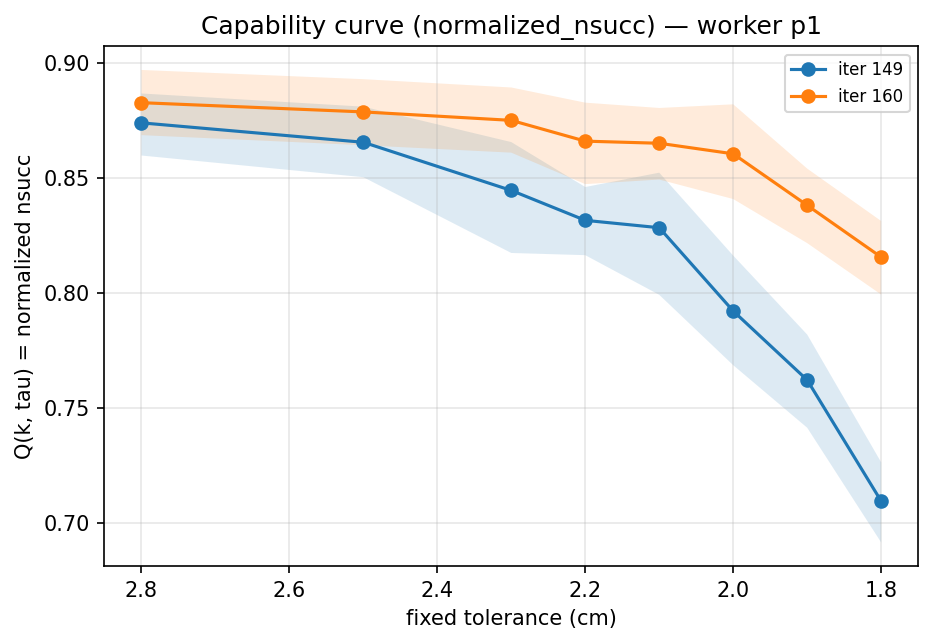
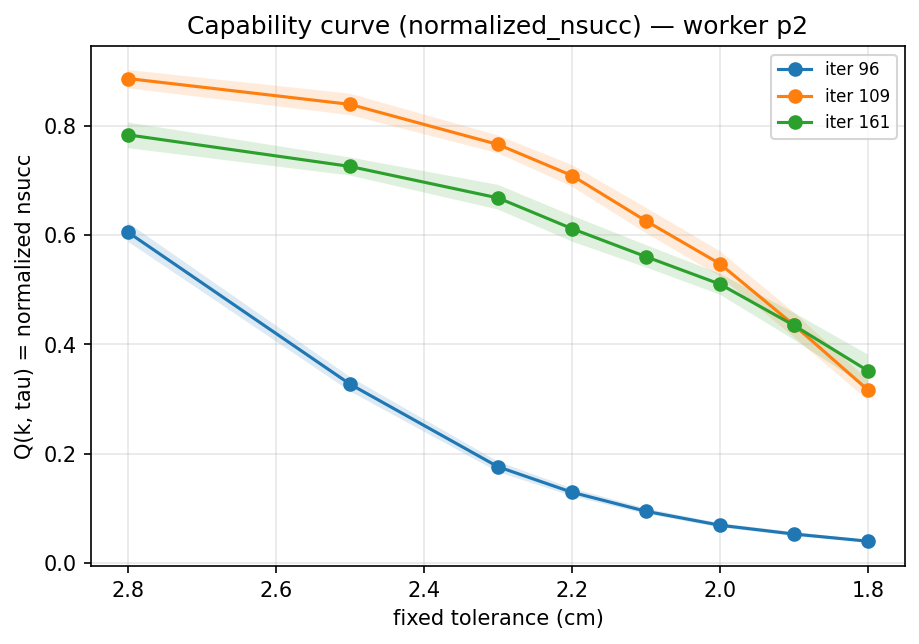
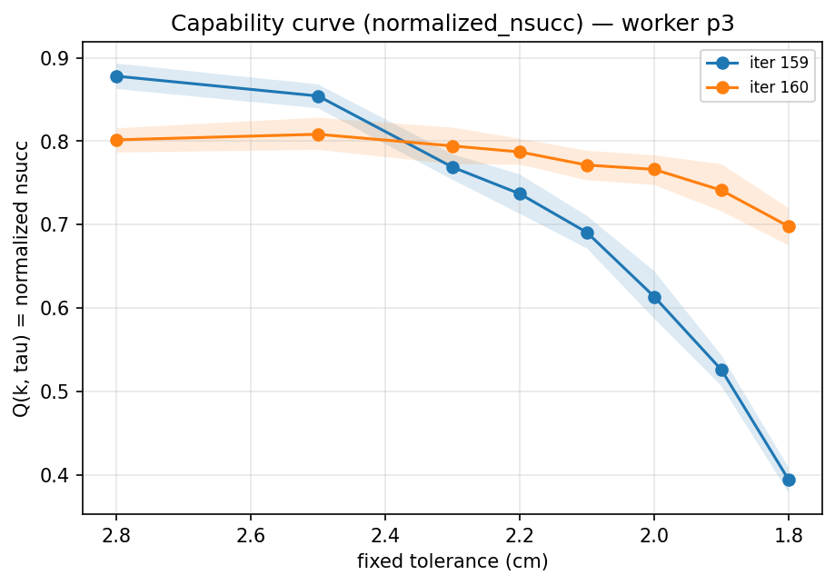
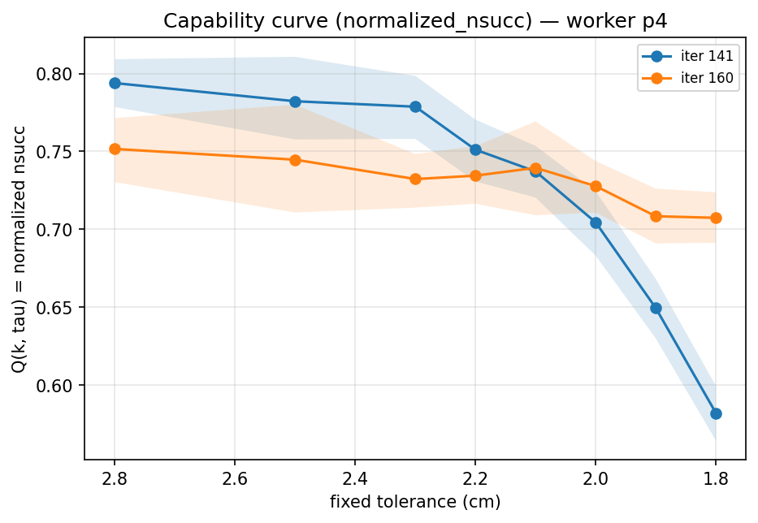
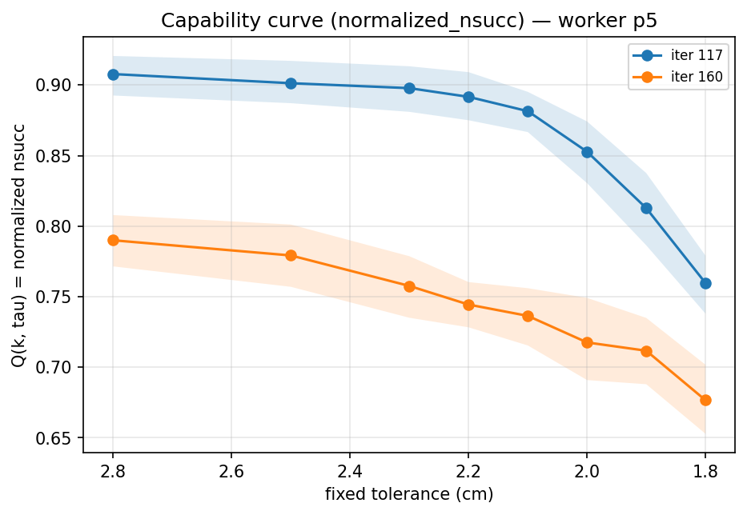
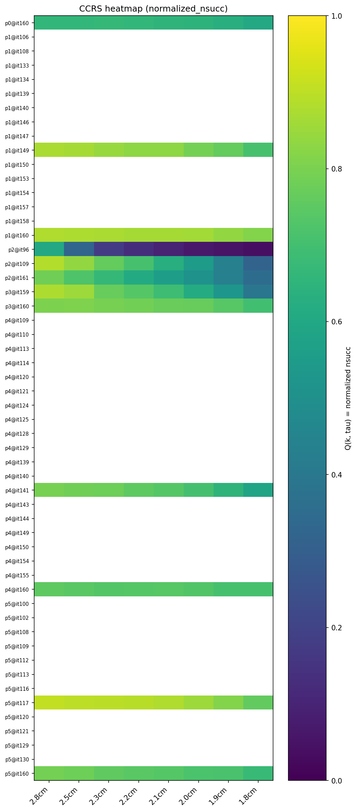
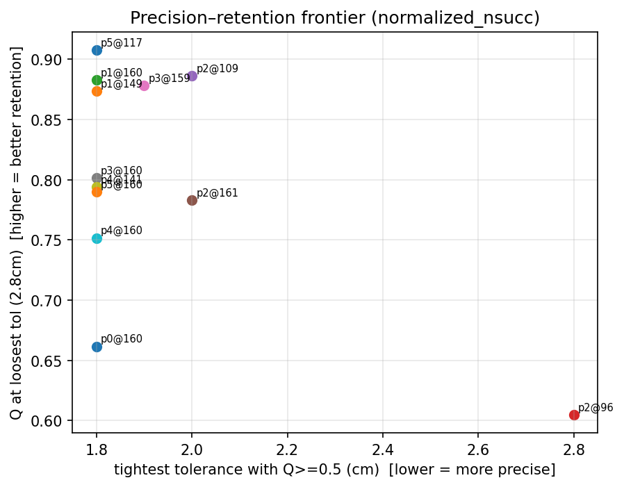
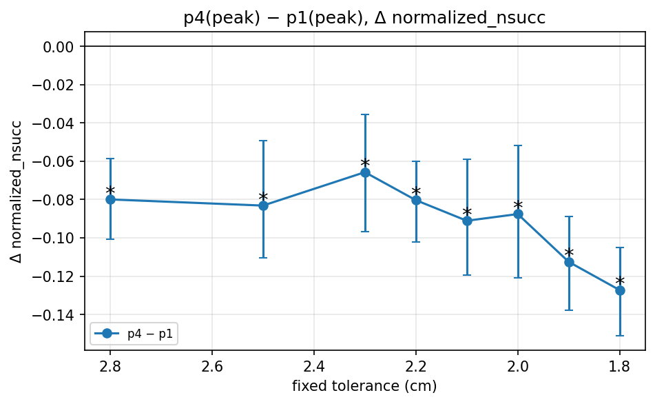
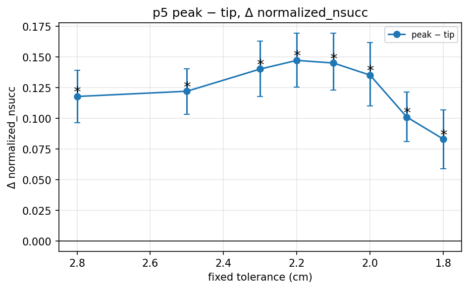
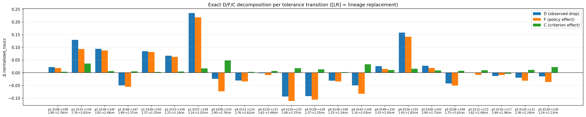
